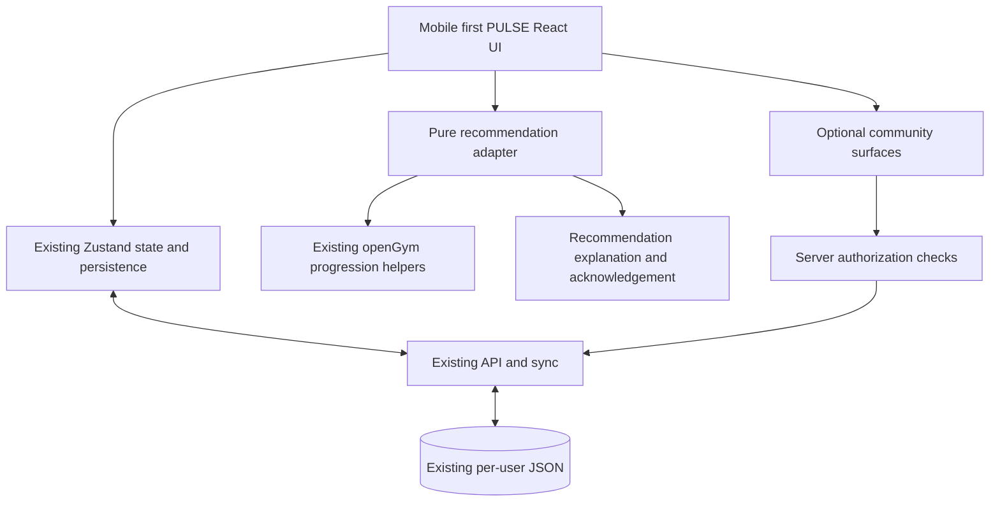

# PULSE — Architecture and integration map
Status: V0.9 design draft, 2026-10-28. **No implementation yet.** See [Master Spec](MASTER_SPEC.md).

## Verified upstream baseline
Source: original `docs/ARCHITECTURE.md`, `frontend/package.json`, `api/package.json`, inspected in the fork.
- React 19 + Vite 8 + React Router 7 + Zustand 5. Capacitor 8 wrappers for Android/iOS, web/PWA and demo modes.
- `frontend/src/App.jsx` routes; `views/`, `components/`, `sheets.jsx` UI; `store/useStore.js` persisted profile state, `store/useUI.js` ephemeral state; `lib/` pure training logic.
- `frontend/src/lib/api.js` handles API calls; `lib/mobile.js` mirrors state in device-private files.
- `api/server.js` uses Node `node:http`; backend persists profiles and states as JSON in `./data`.
- Web served via nginx proxy to API. Offline and local mobile modes already exist.
- Server revision + HTTP 409 state merge: `lib/sync-merge.js` and `api/sync-stamps.js`; parity tests exist. Do NOT replace blindly.
- Existing `mcp/` provides optional assistant integration; upstream docs mention read operations AND logging via API. Audit write authorization before using.
- Optional Coach already exists in `api/coach/` and mobile. Avoid adding a competing uncontrolled AI coach.

## Scope decision: responsive web/PWA first
The only active delivery target is the web application, optimized for phones and usable on desktop. Retain Capacitor source compatibility, but do not prioritize Android/iOS packaging or app-store releases in the current milestones.

## Architecture decision: modular extension, not a rewrite

This diagram is a conceptual target; the repository does not yet contain these PULSE modules.

## Implementation constraints
1. Never bypass `useStore` persistence for workout sets or store a second divergent workout history.
2. New recommendation metadata needs explicit merge semantics and schema evolution; use namespaced, versioned data with durable IDs.
3. Existing progression methods remain authoritative until parity and integration are proven.
4. Authorize all user/group reads and writes on the server; never infer permissions from UI state.
5. Prefer interface-level adapters and pure functions, with focused tests, instead of broad modifications to upstream code.
6. Avoid assuming JSON must be immediately replaced: benchmark public registration, write contention, backup restore and social query requirements first.
7. Mobile native and PWA paths must be exercised separately; do not compromise offline-only mode when adding a hosted-community feature.
8. Keep generated catalogue data untouched; assess media license independently from AGPL code.

## Risk register
- Concurrent updates or offline edits could lose or reorder recommendation decisions: require deterministic merge tests and recovery cases.
- User-to-user data exposure in public mode: direct object authorization and abuse testing are P0 gates.
- Reusing licensed media without rights: inventory images, GIFs and animations before redistribution.
- Overlapping coaching systems: define one decision authority and optional explanation-only AI interaction.
- Fork falling behind upstream security fixes: monitor tags, diff regularly and test upstream merges.

## Proposed change slices
A. Baseline audit: record upstream commit, tests, copyright/media inventory, account and storage behavior.
B. Design tokens and responsive shell with visual regression tests.
C. Guided set-entry UX, data compatibility, offline persistence tests.
D. Deterministic recommendation adapter and rationale logging.
E. Secure public registration/verification, privacy isolation, admin.
F. Optional friends/groups and sharing.
G. Release tests, deployment/backup/rollback.

## Required evidence
Before code changes: list existing tests, latest release and dependencies, screenshots of mobile/desktop baseline, data shape and threat model. Before production: CI green, independent authorization tests, offline+restart+sync tests, manual mobile device testing, license attribution and backup restoration evidence.
